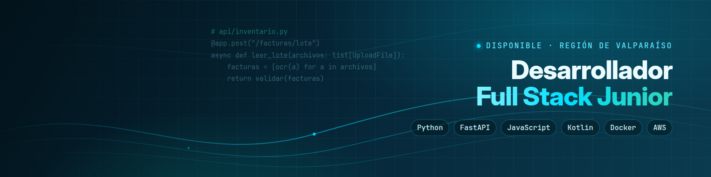

  

<h1 align="center">Hola, soy Ignacio Pérez 👋</h1>

<b>Desarrollador Full Stack Junior</b> · Concón, Región de Valparaíso, Chile

  
  
  

  
  

---

### Sobre mí

Diseño, construyo y despliego mis propias aplicaciones: backends en **Python con FastAPI**, interfaces web en **JavaScript** y apps **Android nativas en Kotlin y Java**, con pruebas automatizadas, Docker y CI en GitHub Actions.

Trabajo como garzón en el sector hotelero y gastronómico desde 2021. Ver la operación desde adentro me mostró problemas que se pueden resolver con software, y de ahí nacen mis proyectos.

- 🎓 Estudio **Analista Programador** en Duoc UC (egreso estimado 2027), después de 4 años de Ingeniería Civil Informática en la UNAB.
- 🌱 Busco mi primer trabajo como desarrollador, en un equipo donde pueda aprender y aportar.
- ⚡ Disponibilidad inmediata, con horario flexible en torno a mis clases.

### Proyectos

| Proyecto | Qué es | Tecnologías |
|---|---|---|
| **Marea** · *prototipo funcional en desarrollo* | Inventario y facturas para el hotel donde trabajo. Lee facturas por lote (foto, PDF y XML de DTE) con OCR local, detecta duplicados y valida totales. API REST con 6 roles de acceso, app Android y 133 pruebas automatizadas. | Python · FastAPI · SQLite · Tesseract · Kotlin · Jetpack Compose · pytest |
| **Aqua** · *en uso diario* | Mi asistente personal de IA en la nube, con cuatro interfaces: bot de Telegram, app web, app de escritorio y un Echo Show 5 con detección local de palabra clave. Agentes especializados con aprobación humana para acciones sensibles. | Python · JavaScript · Java (Android) · Docker Compose · AWS Lightsail · GitHub Actions · n8n |

> El código de estos proyectos es privado. Puedes ver una demo animada de Marea y conversar con Aqua en mi **[portafolio](https://ignacio-perez.vercel.app)**.

### Tecnologías

**Lenguajes**
 

**Backend, web y móvil**
 

**Bases de datos**
 

**DevOps e IA**
 

---

¿Tienes un proyecto o una vacante? Escríbeme a <a href="mailto:ignacioperezo2002@gmail.com">ignacioperezo2002@gmail.com</a> o por <a href="https://www.linkedin.com/in/ignacio-andr%C3%A9s">LinkedIn</a>.

